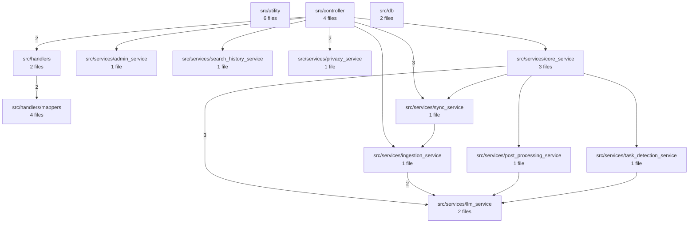

# surfmind-backend — Project Onboarding Guide

_Generated automatically by <a href='https://gnost.readthedocs.io'>GNOST</a>._

## Project Overview

- **Root:** `/Users/mohdzain/Documents/GitHub/surfmind/surfmind-backend`
- **Languages:** python (70)
- **Framework:** FastAPI

## Summary Table

| Language | Files | LOC |
|---|---:|---:|
| Python | 70 | 8585 |

## Stats Table

| Language | Files | Code | Comments | Blanks | LOC |
|---|---:|---:|---:|---:|---:|
| Python | 70 | 6780 | 530 | 1275 | 8585 |

## Get it running

_Read from this project's own files. Each line names its source; nothing is guessed._

**Prerequisites**

- Docker _(docker-compose.yml)_

**Install**

- `pip install -e .` _(pyproject.toml)_
- `make install` _(Makefile)_

**Run**

- `make run` _(Makefile)_
- `docker compose up` _(docker-compose.yml)_

**Test**

- `make check` _(Makefile)_

**Environment variables**

- OPENAI_API_KEY _(.env.example)_
- GEMINI_API_KEY _(.env.example)_
- REDIS_HOST _(.env.example)_
- REDIS_PORT _(.env.example)_
- DATABASE_URL _(.env.example)_
- ENVIRONMENT _(.env.example)_
- DEBUG _(.env.example)_
- PRINT _(.env.example)_

## Entry Points

- `src/controller/main_controller.py` — FastAPI app initialization
- `scripts/add_license_header.py` — __main__ guard
- `scripts/cleanup_test_data.py` — __main__ guard
- `scripts/create_admin.py` — __main__ guard

## Routes

30 endpoints found. Each row is a URL and the code that handles it.

| Method | Path | Handler | File |
|---|---|---|---|
| GET | `/` | `root_health_check` | `src/controller/main_controller.py:78` |
| GET | `/health` | `health_check` | `src/controller/main_controller.py:84` |
| GET | `/v1/admin/accounts` | `list_accounts_route` | `src/controller/admin_controller.py:454` |
| DELETE | `/v1/admin/accounts/{sync_account_id}` | `admin_delete_account_route` | `src/controller/admin_controller.py:846` |
| GET | `/v1/admin/accounts/{sync_account_id}` | `account_detail_route` | `src/controller/admin_controller.py:649` |
| POST | `/v1/admin/accounts/{sync_account_id}/clear-data` | `admin_clear_data_route` | `src/controller/admin_controller.py:802` |
| GET | `/v1/admin/accounts/{sync_account_id}/searches` | `account_searches_route` | `src/controller/admin_controller.py:702` |
| POST | `/v1/admin/accounts/{sync_account_id}/unlink-browser` | `admin_unlink_browser_route` | `src/controller/admin_controller.py:769` |
| POST | `/v1/admin/login` | `login_route` | `src/controller/admin_controller.py:82` |
| GET | `/v1/admin/status/health` | `health_route` | `src/controller/admin_controller.py:92` |
| GET | `/v1/admin/status/llm-usage` | `llm_usage_route` | `src/controller/admin_controller.py:297` |
| GET | `/v1/admin/status/logs` | `logs_route` | `src/controller/admin_controller.py:241` |
| GET | `/v1/admin/status/nginx-logs` | `nginx_logs_route` | `src/controller/admin_controller.py:910` |
| GET | `/v1/admin/status/search-metrics` | `search_metrics_route` | `src/controller/admin_controller.py:371` |
| GET | `/v1/admin/status/stats` | `stats_route` | `src/controller/admin_controller.py:209` |
| POST | `/v1/admin/sync-codes/{code}/revoke` | `admin_revoke_sync_code_route` | `src/controller/admin_controller.py:827` |
| POST | `/v1/recent-searches` | `recent_searches_route` | `src/controller/core_controller.py:471` |
| POST | `/v1/save-data` | `save_data` | `src/controller/core_controller.py:174` |
| POST | `/v1/search` | `search` | `src/controller/core_controller.py:285` |
| POST | `/v1/search-stream` | `search_stream` | `src/controller/core_controller.py:332` |
| POST | `/v1/sync/devices` | `list_devices_route` | `src/controller/sync_controller.py:139` |
| POST | `/v1/sync/devices/rename` | `rename_device_route` | `src/controller/sync_controller.py:152` |
| POST | `/v1/sync/devices/unlink` | `unlink_device_route` | `src/controller/sync_controller.py:176` |
| POST | `/v1/sync/generate-code` | `generate_code_route` | `src/controller/sync_controller.py:50` |
| POST | `/v1/sync/page-counts` | `page_counts_route` | `src/controller/sync_controller.py:120` |
| POST | `/v1/sync/redeem-code` | `redeem_code_route` | `src/controller/sync_controller.py:68` |
| POST | `/v1/sync/status` | `sync_status_route` | `src/controller/sync_controller.py:99` |
| POST | `/v1/sync/unlink` | `unlink_route` | `src/controller/sync_controller.py:87` |
| DELETE | `/v1/user/data` | `clear_all_data_route` | `src/controller/core_controller.py:534` |
| DELETE | `/v1/user/history` | `clear_history_route` | `src/controller/core_controller.py:490` |

## Execution Flow (High Level)

- `src/controller/main_controller.py` → `src/controller/sync_controller.py`
- `src/controller/main_controller.py` → `src/utility/db_log_handler.py`
- `src/controller/main_controller.py` → `src/utility/logger.py`
- `src/controller/main_controller.py` → `src/utility/settings.py`
- `src/controller/main_controller.py` → `src/controller/admin_controller.py` → `src/models/core.py`

_(19 additional paths omitted for clarity.)_

## Function-level Flow

What each entry point calls, function by function (Python only; calls through other objects such as `self.client.send()` are not followed). Full diagrams: [function-flow.md](flow/function-flow.md).

### `POST /v1/save-data` → `save_data`

`src/controller/core_controller.py:174`

- `_default_heading_path` (`src/services/ingestion_service/ingestion.py:101`)
- `resolve_sync_account_id` (`src/services/sync_service/sync.py:124`)
- `_persist_embeddings` (`src/controller/core_controller.py:138`)
  - `_ingest_with_own_session` (`src/controller/core_controller.py:113`)
    - `ingest_batch` (`src/services/ingestion_service/ingestion.py:381`)
      - _..._
  - `ingest_batch` (`src/services/ingestion_service/ingestion.py:381`) _(shown above)_

### `POST /v1/sync/redeem-code` → `redeem_code_route`

`src/controller/sync_controller.py:68`

- `redeem_code` (`src/services/sync_service/sync.py:311`)
  - `_migrate_browser_pages` (`src/services/sync_service/sync.py:258`)
  - `_get_account_tier` (`src/services/ingestion_service/ingestion.py:213`)
  - `_trim_to_cap` (`src/services/ingestion_service/ingestion.py:565`)
    - `_cap_for` (`src/services/ingestion_service/ingestion.py:93`)
  - `_set_sync_account` (`src/services/sync_service/sync.py:159`)
  - `_apply_device_metadata` (`src/services/sync_service/sync.py:96`)
    - `_normalize_device_name` (`src/services/sync_service/sync.py:76`)

### `POST /v1/sync/generate-code` → `generate_code_route`

`src/controller/sync_controller.py:50`

- `generate_code` (`src/services/sync_service/sync.py:187`)
  - `resolve_sync_account_id` (`src/services/sync_service/sync.py:124`)
  - `_delete_expired_codes` (`src/services/sync_service/sync.py:173`)
  - `_apply_device_metadata` (`src/services/sync_service/sync.py:96`)
    - `_normalize_device_name` (`src/services/sync_service/sync.py:76`)
  - `_generate_code` (`src/services/sync_service/sync.py:183`)

### `POST /v1/search-stream` → `search_stream`

`src/controller/core_controller.py:332`

- `resolve_sync_account_id` (`src/services/sync_service/sync.py:124`)
- `_annotate_source_browser` (`src/controller/core_controller.py:73`)
  - `get_device_names` (`src/services/sync_service/sync.py:538`)
- `persist_search` (`src/services/search_history_service/search_history.py:26`)
  - `_trim_to_cap` (`src/services/search_history_service/search_history.py:64`)

### `DELETE /v1/user/history` → `clear_history_route`

`src/controller/core_controller.py:490`

- `resolve_sync_account_id` (`src/services/sync_service/sync.py:124`)
- `resolve_history_clear_range` (`src/services/privacy_service/privacy.py:41`)
- `clear_history` (`src/services/privacy_service/privacy.py:49`)

_...and 16 more entry points in the insights JSON (`--json`)._

## Execution Flow (Overview)

> Grouped by folder to stay readable: 14 folders; numbers on arrows count the file-level imports they stand for.
> Arrows into `src/db`, `src/utility` are not drawn: most folders import them, and drawing every arrow would hide the structure.

> 📌 This diagram shows the high-level execution flow. For the complete flow, see [**flow/flow-full.md**](./flow/FLOW-full.md) Raw Mermaid: [flow/flow-full.mmd](./flow/FLOW-full.mmd) Every file and import, ungrouped (for tools and AI): [flow/flow-complete.mmd](./flow/flow-complete.mmd) Interactive explorer: run `gnost open flow` (the page is `flow.html` in this folder; it is rebuilt, not committed)

## Recommended Reading Order

### Start Here

- `src/controller/main_controller.py`

### Core Logic

- `src/controller/admin_controller.py`
- `src/controller/core_controller.py`
- `src/controller/sync_controller.py`
- `src/db/session.py`
- `src/utility/db_log_handler.py`
- `src/utility/logger.py`
- `src/db/models.py`
- `src/handlers/llm_exception_handler.py`
- `src/handlers/redis_exception_handler.py`
- `src/services/admin_service/admin.py`
- `src/services/core_service/main.py`
- `src/services/ingestion_service/ingestion.py`
- `src/services/privacy_service/privacy.py`
- `src/services/search_history_service/search_history.py`
- `src/services/sync_service/sync.py`
- _...and 14 more (closest to an entry point listed first)_

### Supporting / Leaf Code

- `src/utility/settings.py`
- `src/models/core.py`
- `src/utility/pricing.py`
- `src/db/base.py`
- `src/models/ai_models.py`
- `src/handlers/mappers/base_mapper.py`

## 📘 First Files to Read
- **`src/controller/main_controller.py`**
  - Primary entry point into the application
- **`src/controller/core_controller.py`**
  - Core logic file referenced by multiple execution paths
- **`src/controller/admin_controller.py`**
  - Core logic file referenced by multiple execution paths
- **`src/services/core_service/main.py`**
  - Core logic file referenced by multiple execution paths
- **`scripts/cleanup_test_data.py`**
  - Primary entry point into the application
- **`scripts/create_admin.py`**
  - Primary entry point into the application
- **`src/services/ingestion_service/ingestion.py`**
  - Core logic file referenced by multiple execution paths
- **`scripts/add_license_header.py`**
  - Primary entry point into the application
- **`src/controller/sync_controller.py`**
  - Core logic file referenced by multiple execution paths
- **`src/handlers/llm_exception_handler.py`**
  - Core logic file referenced by multiple execution paths

## ⚠️ Caution Areas
### `src/controller/admin_controller.py`
- **Type:** large_file
- **Severity:** 4
- **Caution score:** 74.5/100
- 827 lines of code; 8 except blocks that neither log nor re-raise; imports 10 project files
### `src/services/ingestion_service/ingestion.py`
- **Type:** high_complexity
- **Severity:** 4
- **Caution score:** 71/100
- A function with complexity 25; 511 lines of code; 3 except blocks that neither log nor re-raise
### `src/services/core_service/rag.py`
- **Type:** large_file
- **Severity:** 3
- **Caution score:** 46.3/100
- 599 lines of code; a function with complexity 15
### `src/services/core_service/main.py`
- **Type:** large_file
- **Severity:** 3
- **Caution score:** 40.9/100
- 625 lines of code; imports 10 project files
### `src/services/sync_service/sync.py`
- **Type:** large_file
- **Severity:** 3
- **Caution score:** 40.6/100
- 605 lines of code; 2 except blocks that neither log nor re-raise

## Change Hotspots

Files that changed most in the last 365 days (54 commits). A file that changes often and is touched by many people is where merge conflicts and regressions tend to start.

| File | Commits | Authors | Last 90 days | Lines changed | Last change |
|---|---:|---:|---:|---|---|
| `src/controller/core_controller.py` | 19 | 1 | 13 | +684 / -127 | 2026-11-26 |
| `src/services/core_service/main.py` | 13 | 1 | 9 | +785 / -88 | 2026-11-26 |
| `src/services/sync_service/sync.py` | 10 | 1 | 9 | +755 / -44 | 2026-11-26 |
| `src/services/core_service/rag.py` | 11 | 1 | 7 | +831 / -169 | 2026-11-26 |
| `src/models/core.py` | 12 | 1 | 6 | +302 / -7 | 2026-11-26 |
| `src/services/ingestion_service/ingestion.py` | 9 | 1 | 8 | +605 / -22 | 2026-11-26 |
| `src/controller/admin_controller.py` | 8 | 1 | 8 | +960 / -23 | 2026-11-26 |
| `src/controller/main_controller.py` | 10 | 1 | 5 | +118 / -18 | 2026-11-26 |
| `src/utility/settings.py` | 8 | 1 | 7 | +301 / -6 | 2026-11-26 |
| `src/db/models.py` | 7 | 1 | 6 | +327 / -0 | 2026-11-26 |
| `src/controller/sync_controller.py` | 7 | 1 | 5 | +219 / -19 | 2026-11-26 |
| `src/services/post_processing_service/post_processing.py` | 7 | 1 | 3 | +184 / -26 | 2026-11-26 |
| `src/utility/logger.py` | 7 | 1 | 3 | +260 / -52 | 2026-11-26 |
| `src/services/privacy_service/privacy.py` | 4 | 1 | 3 | +84 / -6 | 2026-11-26 |
| `src/services/search_history_service/search_history.py` | 4 | 1 | 3 | +105 / -5 | 2026-11-26 |

## Risky and Changing

Files that are fragile to change (high caution score) and also change often. Start here when adding tests or reviewing changes. Risk = caution score scaled by how much the file changes.

| File | Risk | Caution | Change activity | Why fragile | Commits | Authors |
|---|---:|---:|---:|---|---:|---:|
| `src/controller/admin_controller.py` | 58.9 | 74.5 | 79.1 | large file, errors swallowed silently | 8 | 1 |
| `src/services/ingestion_service/ingestion.py` | 57.4 | 71 | 80.8 | complex code, large file | 9 | 1 |
| `src/services/core_service/rag.py` | 38.3 | 46.3 | 82.8 | large file, complex code | 11 | 1 |
| `src/services/core_service/main.py` | 35.9 | 40.9 | 87.8 | large file, imports many files | 13 | 1 |
| `src/services/sync_service/sync.py` | 34.1 | 40.6 | 83.9 | large file, errors swallowed silently | 10 | 1 |
| `src/utility/settings.py` | 30.5 | 39.3 | 77.7 | many files depend on it, large file | 8 | 1 |
| `src/controller/core_controller.py` | 28.3 | 31.4 | 90 | large file, imports many files | 19 | 1 |
| `src/utility/logger.py` | 25.6 | 36.9 | 69.5 | many files depend on it | 7 | 1 |

## 🔁 Circular Dependencies

_No circular dependencies detected._
## Key Execution Paths

To understand specific scenarios, see the entry-based execution paths:

- 📍 [Entry-based Paths](flow/entry-paths.md)

- 🧭 [folder-based Paths](flow/folder-paths.md)

(Whole system: [flow/FLOW-full.md](flow/FLOW-full.md). For a small project it is the same as [flow/flow-complete.mmd](flow/flow-complete.mmd), every file and import; for a big one FLOW-full groups them by folder to stay readable. Interactive: `gnost open flow`.)

---

Generated by [GNOST](https://gnost.readthedocs.io) 0.7.1. Try it on your own code: `uvx gnost onboard .`
