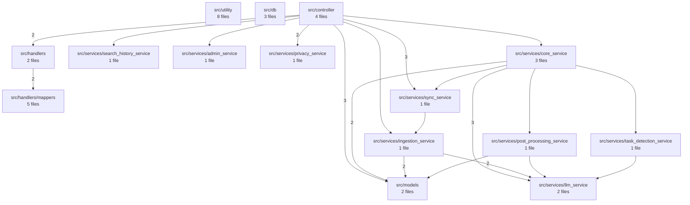
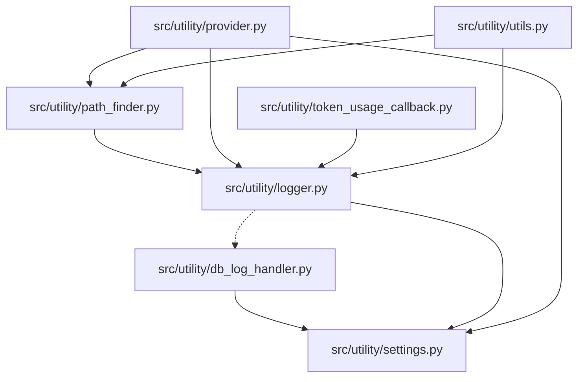
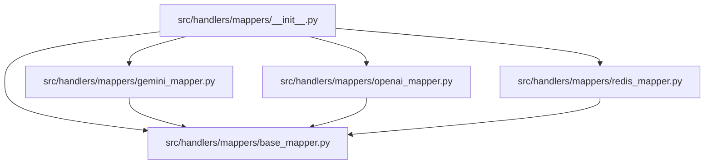
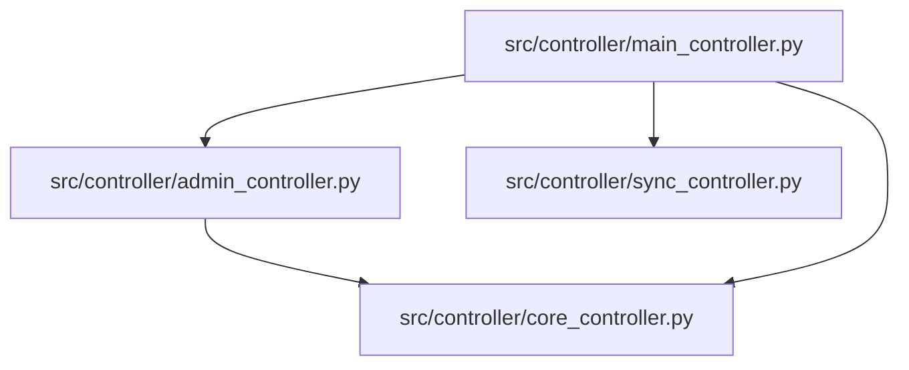
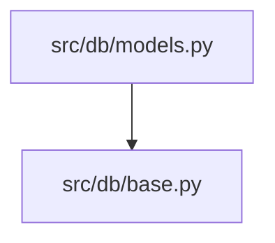
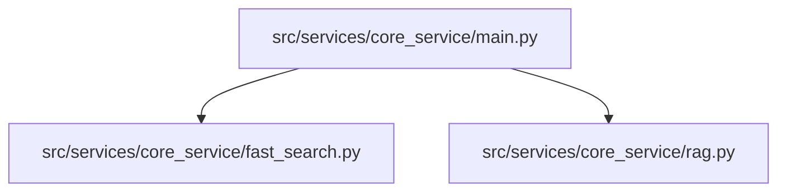

# Full Execution Flow

> Grouped by folder to stay readable: 15 folders; numbers on arrows count the file-level imports they stand for.
> Arrows into `src/db`, `src/utility` are not drawn: most folders import them, and drawing every arrow would hide the structure.

# Detail by folder

The diagram above groups files by folder. These show the files inside the biggest folders.

## `src/utility` (8 files)

> Dotted arrows: imports that do not run when the module loads.

## `src/handlers/mappers` (5 files)

## `src/controller` (4 files)

## `src/db` (3 files)

## `src/services/core_service` (3 files)

> ℹ️ This file renders the complete Mermaid diagram on GitHub.
> For raw Mermaid source, see [**FLOW-full.mmd**](./FLOW-full.mmd). Every file and import, ungrouped and nothing omitted: [**flow-complete.mmd**](./flow-complete.mmd)

---

Generated by [GNOST](https://gnost.readthedocs.io) 0.7.1. Try it on your own code: `uvx gnost onboard .`
