# Entry-based Execution Paths

These diagrams show individual execution paths starting from application entry points. Each path represents one possible flow through the system.

## Path 1 — `src/controller/main_controller.py`

```mermaid
flowchart LR
  src_controller_core_controller_py["src/controller/core_controller.py"]
  src_controller_main_controller_py["src/controller/main_controller.py"]
  src_handlers_llm_exception_handler_py["src/handlers/llm_exception_handler.py"]
  src_handlers_mappers___init___py["src/handlers/mappers/__init__.py"]
  src_handlers_mappers_base_mapper_py["src/handlers/mappers/base_mapper.py"]
  src_controller_core_controller_py --> src_handlers_llm_exception_handler_py
  src_controller_main_controller_py --> src_controller_core_controller_py
  src_handlers_llm_exception_handler_py --> src_handlers_mappers___init___py
  src_handlers_mappers___init___py --> src_handlers_mappers_base_mapper_py
```

**Execution chain:** src/controller/main_controller.py → src/controller/core_controller.py → src/handlers/llm_exception_handler.py → src/handlers/mappers/__init__.py → src/handlers/mappers/base_mapper.py

## Path 2 — `src/controller/main_controller.py`

```mermaid
flowchart LR
  src_controller_core_controller_py["src/controller/core_controller.py"]
  src_controller_main_controller_py["src/controller/main_controller.py"]
  src_handlers_llm_exception_handler_py["src/handlers/llm_exception_handler.py"]
  src_handlers_mappers___init___py["src/handlers/mappers/__init__.py"]
  src_handlers_mappers_gemini_mapper_py["src/handlers/mappers/gemini_mapper.py"]
  src_controller_core_controller_py --> src_handlers_llm_exception_handler_py
  src_controller_main_controller_py --> src_controller_core_controller_py
  src_handlers_llm_exception_handler_py --> src_handlers_mappers___init___py
  src_handlers_mappers___init___py --> src_handlers_mappers_gemini_mapper_py
```

**Execution chain:** src/controller/main_controller.py → src/controller/core_controller.py → src/handlers/llm_exception_handler.py → src/handlers/mappers/__init__.py → src/handlers/mappers/gemini_mapper.py

## Path 3 — `src/controller/main_controller.py`

```mermaid
flowchart LR
  src_controller_core_controller_py["src/controller/core_controller.py"]
  src_controller_main_controller_py["src/controller/main_controller.py"]
  src_handlers_llm_exception_handler_py["src/handlers/llm_exception_handler.py"]
  src_handlers_mappers___init___py["src/handlers/mappers/__init__.py"]
  src_handlers_mappers_openai_mapper_py["src/handlers/mappers/openai_mapper.py"]
  src_controller_core_controller_py --> src_handlers_llm_exception_handler_py
  src_controller_main_controller_py --> src_controller_core_controller_py
  src_handlers_llm_exception_handler_py --> src_handlers_mappers___init___py
  src_handlers_mappers___init___py --> src_handlers_mappers_openai_mapper_py
```

**Execution chain:** src/controller/main_controller.py → src/controller/core_controller.py → src/handlers/llm_exception_handler.py → src/handlers/mappers/__init__.py → src/handlers/mappers/openai_mapper.py

---

Generated by [GNOST](https://gnost.readthedocs.io) 0.7.1. Try it on your own code: `uvx gnost onboard .`
