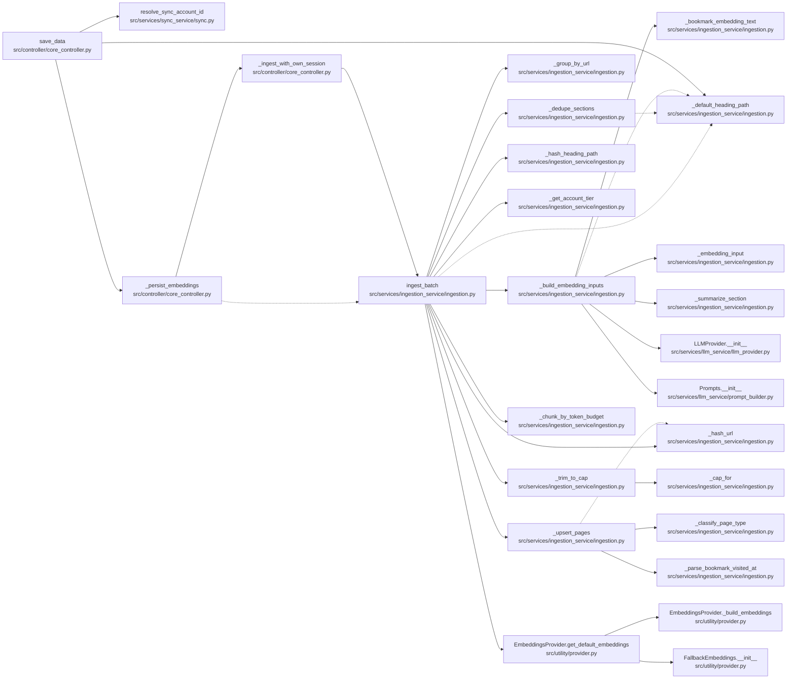
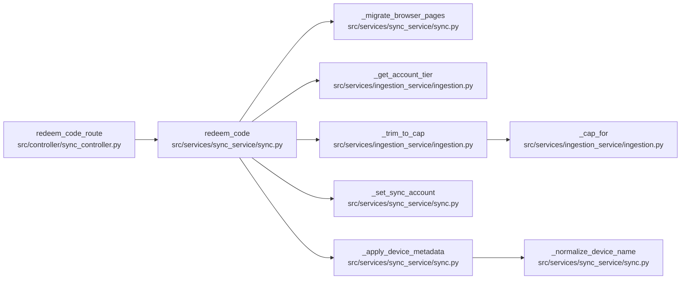
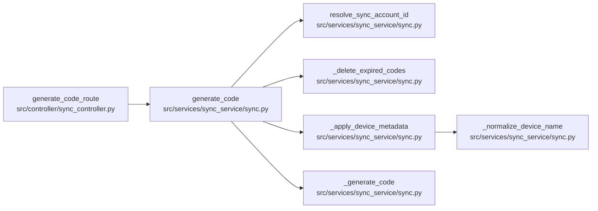
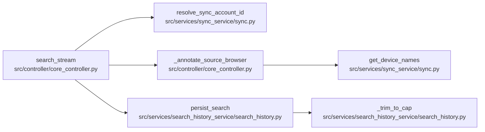
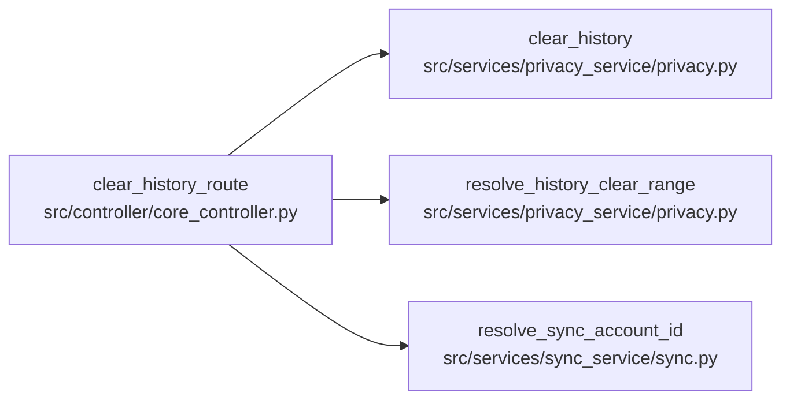

# Function-level Flow

What each entry point calls, function by function (Python only). Dotted arrows lead to a function already drawn elsewhere in the same diagram. Calls through other objects (`self.client.send()`) are not followed.

## `POST /v1/save-data` → `save_data`

`src/controller/core_controller.py:174` · 26 functions · cut short

## `POST /v1/sync/redeem-code` → `redeem_code_route`

`src/controller/sync_controller.py:68` · 9 functions

## `POST /v1/sync/generate-code` → `generate_code_route`

`src/controller/sync_controller.py:50` · 7 functions

## `POST /v1/search-stream` → `search_stream`

`src/controller/core_controller.py:332` · 6 functions

## `DELETE /v1/user/history` → `clear_history_route`

`src/controller/core_controller.py:490` · 4 functions

_...and 16 more entry points; see the insights JSON (`--json`)._

---

Generated by [GNOST](https://gnost.readthedocs.io) 0.7.1. Try it on your own code: `uvx gnost onboard .`
