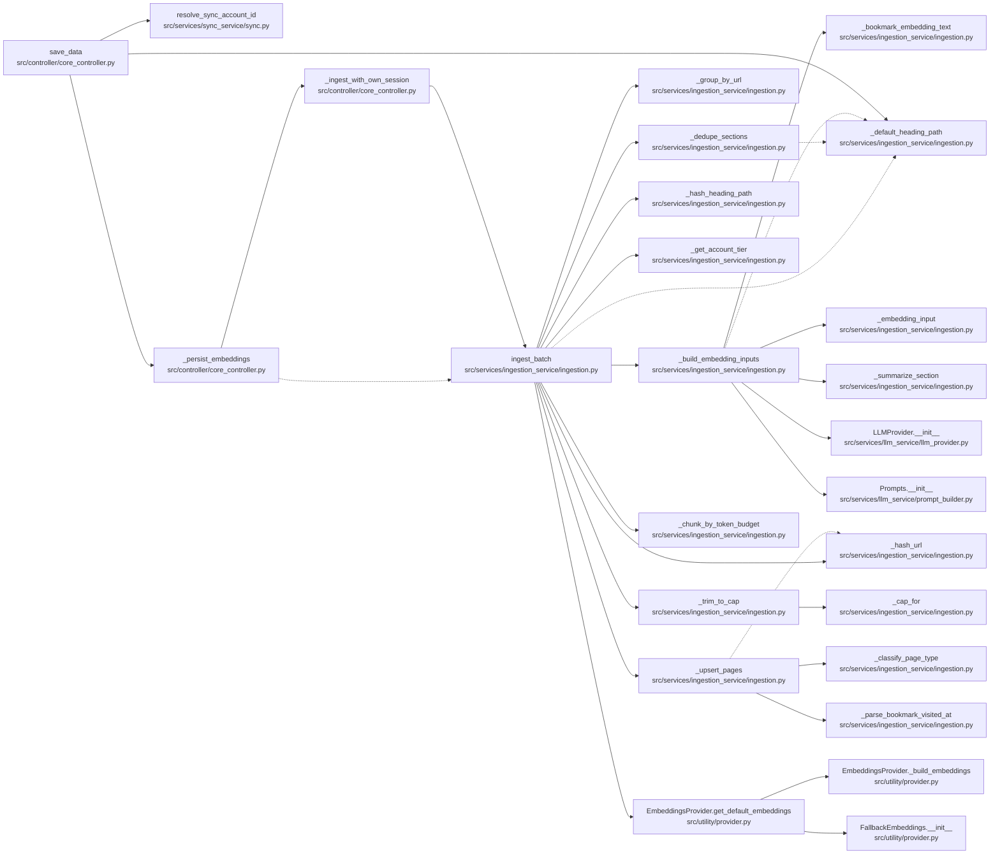
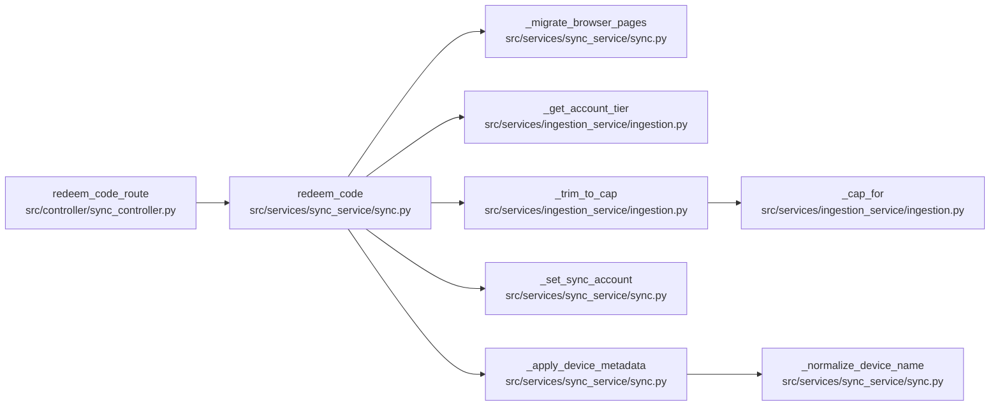

# Function-level Flow

What each entry point calls, function by function (Python only). Dotted arrows lead to a function already drawn elsewhere in the same diagram. Calls through other objects (`self.client.send()`) are not followed.

## `POST /v1/save-data` → `save_data`

`src/controller/core_controller.py:170` · 26 functions · cut short

## `POST /v1/categories/enable` → `enable_route`

`src/controller/category_controller.py:184` · 15 functions · cut short

```mermaid
flowchart LR
  src_controller_category_controller_py__enable_route["enable_route<br/>src/controller/category_controller.py"]
  src_services_sync_service_sync_py__resolve_sync_account_id["resolve_sync_account_id<br/>src/services/sync_service/sync.py"]
  src_services_category_service_category_py__enable_categorization["enable_categorization<br/>src/services/category_service/category.py"]
  src_services_category_service_category_py__is_categorization_enabled["is_categorization_enabled<br/>src/services/category_service/category.py"]
  src_services_category_service_category_py___create_default_categories["_create_default_categories<br/>src/services/category_service/category.py"]
  src_services_classification_service_tasks_py__classify_pages_task["classify_pages_task<br/>src/services/classification_service/tasks.py"]
  src_services_classification_service_tasks_py___run_and_dispose["_run_and_dispose<br/>src/services/classification_service/tasks.py"]
  src_services_classification_service_tasks_py__classify_pages_async["classify_pages_async<br/>src/services/classification_service/tasks.py"]
  src_services_category_service_category_py__list_categories["list_categories<br/>src/services/category_service/category.py"]
  src_services_classification_service_tasks_py___get_classification_targets["_get_classification_targets<br/>src/services/classification_service/tasks.py"]
  src_services_classification_service_classify_py__PageClassifier___init__["PageClassifier.__init__<br/>src/services/classification_service/classify.py"]
  src_services_llm_service_llm_provider_py__LLMProvider___init__["LLMProvider.__init__<br/>src/services/llm_service/llm_provider.py"]
  src_utility_provider_py__SecretsProvider_get_openai_api_key["SecretsProvider.get_openai_api_key<br/>src/utility/provider.py"]
  src_utility_provider_py__SecretsProvider_get_gemini_api_key["SecretsProvider.get_gemini_api_key<br/>src/utility/provider.py"]
  src_services_llm_service_llm_provider_py__LLMProvider__build_chat_model["LLMProvider._build_chat_model<br/>src/services/llm_service/llm_provider.py"]
  src_controller_category_controller_py__enable_route --> src_services_category_service_category_py__enable_categorization
  src_controller_category_controller_py__enable_route --> src_services_classification_service_tasks_py__classify_pages_task
  src_controller_category_controller_py__enable_route --> src_services_sync_service_sync_py__resolve_sync_account_id
  src_services_category_service_category_py__enable_categorization --> src_services_category_service_category_py___create_default_categories
  src_services_category_service_category_py__enable_categorization --> src_services_category_service_category_py__is_categorization_enabled
  src_services_classification_service_tasks_py___run_and_dispose --> src_services_classification_service_tasks_py__classify_pages_async
  src_services_classification_service_tasks_py__classify_pages_async --> src_services_category_service_category_py__list_categories
  src_services_classification_service_tasks_py__classify_pages_async --> src_services_classification_service_classify_py__PageClassifier___init__
  src_services_classification_service_tasks_py__classify_pages_async --> src_services_classification_service_tasks_py___get_classification_targets
  src_services_classification_service_tasks_py__classify_pages_async --> src_services_llm_service_llm_provider_py__LLMProvider___init__
  src_services_classification_service_tasks_py__classify_pages_task --> src_services_classification_service_tasks_py___run_and_dispose
  src_services_llm_service_llm_provider_py__LLMProvider___init__ --> src_services_llm_service_llm_provider_py__LLMProvider__build_chat_model
  src_services_llm_service_llm_provider_py__LLMProvider___init__ --> src_utility_provider_py__SecretsProvider_get_gemini_api_key
  src_services_llm_service_llm_provider_py__LLMProvider___init__ --> src_utility_provider_py__SecretsProvider_get_openai_api_key
```

## `POST /v1/categories/refresh` → `refresh_route`

`src/controller/category_controller.py:242` · 15 functions · cut short

```mermaid
flowchart LR
  src_controller_category_controller_py__refresh_route["refresh_route<br/>src/controller/category_controller.py"]
  src_services_sync_service_sync_py__resolve_sync_account_id["resolve_sync_account_id<br/>src/services/sync_service/sync.py"]
  src_services_category_service_category_py__is_categorization_enabled["is_categorization_enabled<br/>src/services/category_service/category.py"]
  src_services_category_service_category_py__get_refresh_available_at["get_refresh_available_at<br/>src/services/category_service/category.py"]
  src_services_category_service_category_py__refresh_categorization["refresh_categorization<br/>src/services/category_service/category.py"]
  src_services_classification_service_tasks_py__classify_pages_task["classify_pages_task<br/>src/services/classification_service/tasks.py"]
  src_services_classification_service_tasks_py___run_and_dispose["_run_and_dispose<br/>src/services/classification_service/tasks.py"]
  src_services_classification_service_tasks_py__classify_pages_async["classify_pages_async<br/>src/services/classification_service/tasks.py"]
  src_services_category_service_category_py__list_categories["list_categories<br/>src/services/category_service/category.py"]
  src_services_classification_service_tasks_py___get_classification_targets["_get_classification_targets<br/>src/services/classification_service/tasks.py"]
  src_services_classification_service_classify_py__PageClassifier___init__["PageClassifier.__init__<br/>src/services/classification_service/classify.py"]
  src_services_llm_service_llm_provider_py__LLMProvider___init__["LLMProvider.__init__<br/>src/services/llm_service/llm_provider.py"]
  src_utility_provider_py__SecretsProvider_get_openai_api_key["SecretsProvider.get_openai_api_key<br/>src/utility/provider.py"]
  src_utility_provider_py__SecretsProvider_get_gemini_api_key["SecretsProvider.get_gemini_api_key<br/>src/utility/provider.py"]
  src_services_llm_service_llm_provider_py__LLMProvider__build_chat_model["LLMProvider._build_chat_model<br/>src/services/llm_service/llm_provider.py"]
  src_controller_category_controller_py__refresh_route --> src_services_category_service_category_py__get_refresh_available_at
  src_controller_category_controller_py__refresh_route --> src_services_category_service_category_py__is_categorization_enabled
  src_controller_category_controller_py__refresh_route --> src_services_category_service_category_py__refresh_categorization
  src_controller_category_controller_py__refresh_route --> src_services_classification_service_tasks_py__classify_pages_task
  src_controller_category_controller_py__refresh_route --> src_services_sync_service_sync_py__resolve_sync_account_id
  src_services_classification_service_tasks_py___run_and_dispose --> src_services_classification_service_tasks_py__classify_pages_async
  src_services_classification_service_tasks_py__classify_pages_async --> src_services_category_service_category_py__list_categories
  src_services_classification_service_tasks_py__classify_pages_async --> src_services_classification_service_classify_py__PageClassifier___init__
  src_services_classification_service_tasks_py__classify_pages_async --> src_services_classification_service_tasks_py___get_classification_targets
  src_services_classification_service_tasks_py__classify_pages_async --> src_services_llm_service_llm_provider_py__LLMProvider___init__
  src_services_classification_service_tasks_py__classify_pages_task --> src_services_classification_service_tasks_py___run_and_dispose
  src_services_llm_service_llm_provider_py__LLMProvider___init__ --> src_services_llm_service_llm_provider_py__LLMProvider__build_chat_model
  src_services_llm_service_llm_provider_py__LLMProvider___init__ --> src_utility_provider_py__SecretsProvider_get_gemini_api_key
  src_services_llm_service_llm_provider_py__LLMProvider___init__ --> src_utility_provider_py__SecretsProvider_get_openai_api_key
```

## `POST /v1/categories/classify` → `classify_route`

`src/controller/category_controller.py:214` · 14 functions · cut short

```mermaid
flowchart LR
  src_controller_category_controller_py__classify_route["classify_route<br/>src/controller/category_controller.py"]
  src_services_sync_service_sync_py__resolve_sync_account_id["resolve_sync_account_id<br/>src/services/sync_service/sync.py"]
  src_services_category_service_category_py__is_categorization_enabled["is_categorization_enabled<br/>src/services/category_service/category.py"]
  src_services_classification_service_tasks_py__count_unclassified_pages["count_unclassified_pages<br/>src/services/classification_service/tasks.py"]
  src_services_classification_service_tasks_py__classify_pages_task["classify_pages_task<br/>src/services/classification_service/tasks.py"]
  src_services_classification_service_tasks_py___run_and_dispose["_run_and_dispose<br/>src/services/classification_service/tasks.py"]
  src_services_classification_service_tasks_py__classify_pages_async["classify_pages_async<br/>src/services/classification_service/tasks.py"]
  src_services_category_service_category_py__list_categories["list_categories<br/>src/services/category_service/category.py"]
  src_services_classification_service_tasks_py___get_classification_targets["_get_classification_targets<br/>src/services/classification_service/tasks.py"]
  src_services_classification_service_classify_py__PageClassifier___init__["PageClassifier.__init__<br/>src/services/classification_service/classify.py"]
  src_services_llm_service_llm_provider_py__LLMProvider___init__["LLMProvider.__init__<br/>src/services/llm_service/llm_provider.py"]
  src_utility_provider_py__SecretsProvider_get_openai_api_key["SecretsProvider.get_openai_api_key<br/>src/utility/provider.py"]
  src_utility_provider_py__SecretsProvider_get_gemini_api_key["SecretsProvider.get_gemini_api_key<br/>src/utility/provider.py"]
  src_services_llm_service_llm_provider_py__LLMProvider__build_chat_model["LLMProvider._build_chat_model<br/>src/services/llm_service/llm_provider.py"]
  src_controller_category_controller_py__classify_route --> src_services_category_service_category_py__is_categorization_enabled
  src_controller_category_controller_py__classify_route --> src_services_classification_service_tasks_py__classify_pages_task
  src_controller_category_controller_py__classify_route --> src_services_classification_service_tasks_py__count_unclassified_pages
  src_controller_category_controller_py__classify_route --> src_services_sync_service_sync_py__resolve_sync_account_id
  src_services_classification_service_tasks_py___run_and_dispose --> src_services_classification_service_tasks_py__classify_pages_async
  src_services_classification_service_tasks_py__classify_pages_async --> src_services_category_service_category_py__list_categories
  src_services_classification_service_tasks_py__classify_pages_async --> src_services_classification_service_classify_py__PageClassifier___init__
  src_services_classification_service_tasks_py__classify_pages_async --> src_services_classification_service_tasks_py___get_classification_targets
  src_services_classification_service_tasks_py__classify_pages_async --> src_services_llm_service_llm_provider_py__LLMProvider___init__
  src_services_classification_service_tasks_py__classify_pages_task --> src_services_classification_service_tasks_py___run_and_dispose
  src_services_llm_service_llm_provider_py__LLMProvider___init__ --> src_services_llm_service_llm_provider_py__LLMProvider__build_chat_model
  src_services_llm_service_llm_provider_py__LLMProvider___init__ --> src_utility_provider_py__SecretsProvider_get_gemini_api_key
  src_services_llm_service_llm_provider_py__LLMProvider___init__ --> src_utility_provider_py__SecretsProvider_get_openai_api_key
```

## `POST /v1/sync/redeem-code` → `redeem_code_route`

`src/controller/sync_controller.py:64` · 9 functions

_...and 20 more entry points; see the insights JSON (`--json`)._

---

Generated by [GNOST](https://gnost.readthedocs.io) 0.7.0. Try it on your own code: `uvx gnost onboard .`
